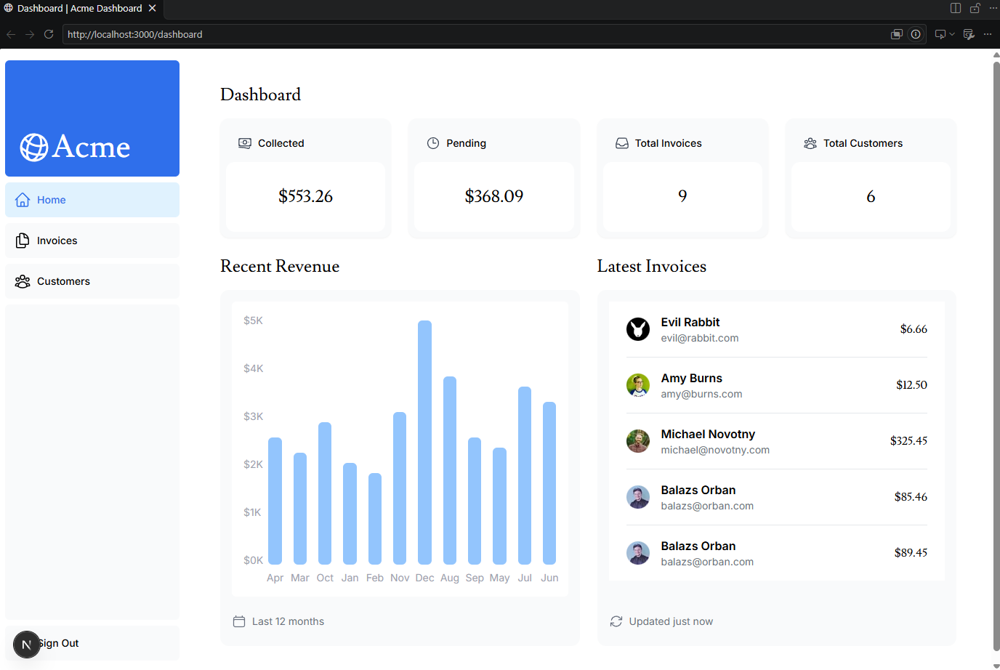

## Next.js App Router Course - Starter

This is the starter template for the Next.js App Router Course. It contains the starting code for the dashboard application.

For more information, see the [course curriculum](https://nextjs.org/learn) on the Next.js Website.
=======
# October
# Financial Dashboard

A full-stack financial dashboard built with Next.js, TypeScript, and PostgreSQL. Users can authenticate securely, view real-time revenue analytics, and create, search, update, and delete customer invoices.

🔗 **Live Demo:** (https://october-3y51xg005-vlhopkins17-8498.vercel.app/)


## Features

- **Authentication & Route Protection:** Secure login flow powered by NextAuth.js v5 with middleware protection for dashboard routes.
- **Full CRUD Invoice Management:** Create, edit, paginate, search, and delete invoices with server-side validation using Zod.
- **Data Visualization & Metrics:** Interactive revenue charts and summary cards displaying collected, pending, and total invoice metrics.
- **Performance Optimization:** Built with React Server Components, streaming with Suspense, and debounced search inputs.
- **Responsive UI:** Accessible, mobile-first interface styled with Tailwind CSS and Heroicons.

## Tech Stack

- **Framework:** Next.js (App Router) & React
- **Language:** TypeScript
- **Database:** PostgreSQL (`postgres`)
- **Authentication:** NextAuth.js (Auth.js v5)
- **Validation:** Zod
- **Styling:** Tailwind CSS & Heroicons
- **Package Manager:** pnpm

## Getting Started

### Prerequisites

- Node.js 18+
- pnpm (`npm install -g pnpm`)
- A PostgreSQL database instance

### Local Installation

1. **Clone the repository:**
   ```bash
   git clone https://github.com
   cd your-repo-name
   ```

2. **Install dependencies:**
   ```bash
   pnpm install
   ```

3. **Configure environment variables:**
   Create a `.env` file in the root directory based on `.env.example` and add your database and authentication secrets:
   ```env
   POSTGRES_URL="your-postgres-connection-string"
   AUTH_SECRET="your-auth-secret"
   ```

4. **Run the development server:**
   ```bash
   pnpm dev
   ```
   Open [http://localhost:3000](http://localhost:3000) in your browser to view the application.


